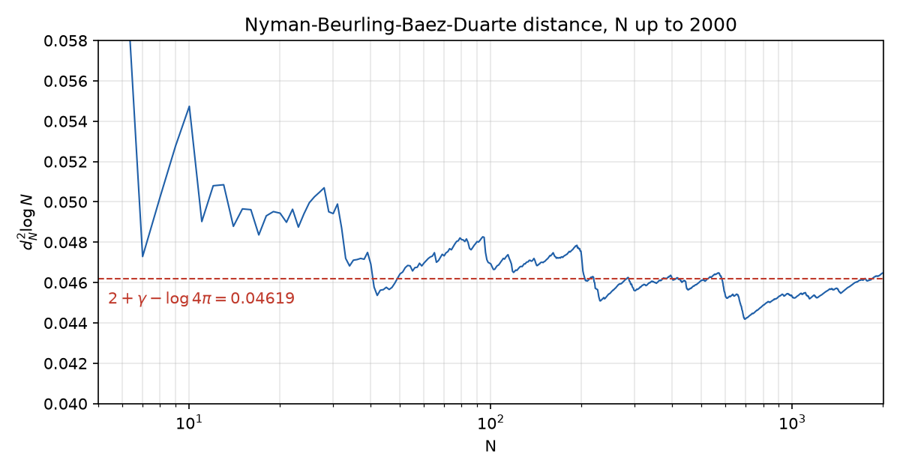

# zeta-checker

Tools for checking claimed proofs of the Riemann Hypothesis.

Two claims came out on 2026-11-20. Levent Alpöge released a Lean 4 development
with a short note ([alpo.ge/remark.pdf](https://alpo.ge/remark.pdf)), and Ravi
Vakil posted Alessandro Masullo's manuscript on the Generalized Riemann
Hypothesis ([announcement](https://math216.wordpress.com/2026/11/20/hurried-announcement-alessandro-masullo-grh/)).
This repo checks them mechanically: what exactly the Lean code states, whether
anything in it gets around the kernel, how the proof is put together, and what
the manuscript claims, section by section.

It doesn't host either author's files. The scripts download them, check them
against recorded hashes and work on local copies.

Nothing here judges whether the mathematics is right. That is for the people
reading the proofs. Every number reported comes with the command that produced
it.

## What runs where

Everything in this repo reads files as text. It never builds, elaborates or runs
the downloaded Lean code: a lakefile, a macro, `#eval`, `run_cmd` or `initialize`
can execute arbitrary programs, so anything that executes the development belongs
in a throwaway Linux sandbox, not on a laptop.

A kernel check of this development doesn't fit on a free GitHub runner (4 vCPU,
16 GB, 14 GB of disk, 6 hours per job). The comparator setup above reports a build on
48 cores and 503 GB of RAM on course for 7 to 10 hours, Lake setup files totalling
around a terabyte if they are not deleted during the build, and an independent export
of 61.6 GB that peaked at 163 GB of memory. So this repo stops at static checks and
points to those runs for the kernel replay.

## Install

```
python -m venv .venv
.venv/bin/pip install -e ".[dev]"
```

Python 3.10 or newer. `pdftotext` (poppler) is used for PDFs when it is on the
PATH, with pypdf as the fallback. `--chart` needs matplotlib (the `plot` extra, also
part of `dev`).

All commands take `-w/--workspace`, a folder outside the repo for downloads and
outputs (or set `ZETA_CHECKER_WORKSPACE`). Run anything that reads the downloads
with `python -I` so nothing from the current folder gets imported.

## The pipeline

```
zeta-checker fetch --record             download into <workspace>/downloads, hash, record
zeta-checker fetch                      verify local files against manifest.json
zeta-checker fetch --rehash             stream every source again and compare hashes
zeta-checker extract --list             check the split tarball without writing anything
zeta-checker extract                    extract into <workspace>/alpoge_lean
zeta-checker pdftext <pdf>...           page-numbered text and outline into <workspace>/text
zeta-checker find <txt> <regex>         grep that prints page numbers
zeta-checker inventory <dir>            files, lines and bytes by extension and folder
zeta-checker config <lean-project>      toolchain, pins, Lake options, lib coverage
zeta-checker scan <lean-project>        escape hatches, grouped by risk
zeta-checker statements <lean-project>  top-level statements traced to their definitions
zeta-checker imports <lean-project>     import graph and the cone of the statement modules
zeta-checker decls <lean-project>       declaration graph and its dominator tree
zeta-checker manuscript <txt>           numbered results, cross-references, markers, citations
zeta-checker audit <lean-project>       every static check on a project, one JSON report
zeta-checker forms                      the statement library of RH and its equivalents
zeta-checker criteria                   Robin, Lagarias, Li and Báez-Duarte, numerically
zeta-checker li                         Li coefficients from the contour, the zeros and intervals
```

`inventory`, `scan`, `statements`, `imports` and `decls` also take `--archive STEM --under DIR`
to read the `.lean` files straight out of the hashed tarball instead of the extracted
copy. On Windows that matters: opening 175,000 small files one by one is slow when an
antivirus checks each open, while the tar stream is 14 opens.

`manifest.json` holds the URL, size, SHA-256 and the server's ETag and
Last-Modified for each of the 16 files. A rerun of `fetch` fails if a local file no
longer matches, and `fetch --upstream` flags a changed ETag or size on the server.
`extract` also hashes the 14 parts as one stream before it reads a member, and the
manifest records that joined digest: 239,275,554 bytes, SHA-256
`9631b4f020199e580ba86178cb56c6e9b09f690c2369a80dc4334aa93f49c7fc`. The community's
comparator setup
([leanprover-community/riemann-hypothesis](https://github.com/leanprover-community/riemann-hypothesis),
`verification/NOTES.md`) publishes the same digest for its copy, so both read identical
bytes.
`fetch --upstream` also asks for the part after the last one. The server answers any
path with an HTML page and status 200, so the probe looks at the content type, not the
status, before it reports a new part.

The alpo.ge parts come without a Content-Length on HEAD and the server ignores
Range requests for them, so the downloader verifies sizes from the GET response,
resumes with Range where a server allows it and restarts where it doesn't.

## Safe extraction

The archive is 14 parts that concatenate into one gzip stream. `extract` reads the
parts through a concatenating reader, so no joined copy is written. It makes two
passes. The first decompresses everything and checks every member: symlinks, hard
links, device files, FIFOs, absolute paths and `..` components are refused, and so
are names that would misbehave on Windows (reserved names like `aux.lean`, `:` and
other forbidden characters, trailing dots) and names that collide case-insensitively
or where a file and a folder share a path. The gzip CRC is checked to the end of the
stream. Only a clean listing gets a second pass, which writes regular files with
exclusive-create, so nothing already on disk is overwritten.

Some paths in the development are longer than 260 characters once they sit under a
workspace folder. Windows refuses those unless long paths are enabled system-wide,
so every write and walk goes through `\\?\` extended-length paths instead.

## The escape-hatch scanner

A grep for `sorry` is easy to fool in both directions: the word sits in comments and
docstrings, and a real `sorry` can hide after a string that contains `--`. The
scanner first masks a Lean file the way Lean's own tokenizer would see it, then
matches on code only. The masker handles nested `/- -/` comments, doc comments,
string escapes and gaps, raw strings `r#"..."#`, interpolated strings (`s!`, `m!`,
`f!`, where the `{...}` parts are code), character literals versus primes in names
like `f'`, and `«guillemet»` names, which may legally contain `--` or `/-`.

The rules come from the Lean reference's guide to validating a proof, the
comparator tool and the usual ways to slip a proof past `#print axioms`:

| group | what it catches |
|---|---|
| unproven | `sorry`, `admit`, `stop`, `sorryAx`, `mkSorry`, `MVarId.admit` |
| axioms | every `axiom` declaration, with its name |
| kernel | `set_option debug.skipKernelTC`, `addDecl`, `addDeclWithoutChecking`, `modifyEnv`, `setEnv` |
| compiler | `native_decide`, `decide +native`, `Lean.ofReduceBool`, `trustCompiler`, `@[implemented_by]`, `@[extern]`, `@[csimp]` |
| unchecked | `opaque`, `unsafe`, `partial`, `unsafeCast`, `MVarId.assign` |
| meta | `macro`, `macro_rules`, `elab`, `syntax`, `notation`, `infix`, name literals like ``` ``sorryAx ``` |
| exec | `#eval`, `run_cmd`, `initialize`, `IO.Process` |
| options | every `set_option`, ranked by what the option can change |

`MVarId.assign` closes a goal with a term the elaborator never checked against the
goal's type. That is sound as long as the kernel checks the finished declaration, but
it means the kernel is the only check, so those proofs are the ones to replay with an
independent checker. The rule came from comparing this scanner with the static scan
in the community's comparator setup, which lists two such tactics in the development.

Attribute names only count inside `@[...]` or `attribute [...]`, and an escaped
`«sorry»` is a plain identifier, reported separately. The tests plant every hatch in
`tests/fixtures/lean/planted.lean`, including a `sorry` inside a macro and one
inside an interpolated string, and put decoys in `decoys.lean`; each expected hit is
written next to its line, so the test is the file itself. Run on the fixtures:

```
$ zeta-checker scan tests/fixtures/lean --risk critical --show 1
2 files, 126 lines, 4126 bytes scanned
risk      group      rule                           hits  files
critical  unproven   sorry                            10      1
critical  unproven   MVarId.admit                      1      1
critical  unproven   admit                             1      1
critical  axioms     axiom                             1      1
critical  unproven   mkSorry                           1      1
critical  kernel     set_option debug.skipKernelTC     1      1
critical  unproven   stop                              1      1
high      exec       Process                           1      1
high      compiler   decide +native                    1      1
...
[critical] sorry
  planted.lean:9  theorem plain : 2 + 2 = 5 := sorry  -- expect: sorry
```

A static scan is a triage step. It says where to look and which lines need a human;
it can't prove the absence of tricks that only show up after elaboration. That is
what `#print axioms`, lean4checker and comparator in a sandbox are for.

## Statements

`statements` reads the modules a Lakefile lists as roots, prints every theorem with
its exact signature and unfolds statement definitions. It splits a statement into
binders, premises and conclusion, so `∀ (s : ℂ) (_ : riemannZeta s = 0) ...` and
`∀ s : ℂ, riemannZeta s = 0 → ...` line up item by item, and compares against
Mathlib's `RiemannHypothesis` (copied from `Mathlib/NumberTheory/LSeries/RiemannZeta.lean`
at the pinned commit). On the test project, a restatement that writes the cast
`(n : ℂ)` explicitly comes out as:

```
  against RiemannHypothesis (leanprover-community/mathlib4@0df444a360ea Mathlib/NumberTheory/LSeries/RiemannZeta.lean:185)
    binder     same
    premise    same
    premise    only here: `(`; only here: `: ℂ )`
      here:    ¬∃ n : ℕ, s = -2 * ((n : ℂ) + 1)
      mathlib: ¬∃ n : ℕ, s = -2 * (n + 1)
    premise    same
    conclusion same
```

It then searches the whole tree for declarations that reuse a name from the
statements and for `notation`, `syntax` or macros whose atoms mention one, which is
how a statement can be made to mean something other than what it says. The fixture
project plants both (`def riemannZeta` in a side namespace and
`notation "RiemannHypothesis" => True`), and the test checks that both are found.

## Declaration graph

`decls` builds a graph of declarations from source text alone. Each theorem, def,
structure and instance is a node, and an edge goes from a declaration to every
project name its signature or proof mentions. Names are resolved the way Lean would
look them up: the declaration's own namespaces from the innermost out (a
`theorem Foo.bar` inside `namespace A` sees `A.Foo`, `A` and the root), then the
file's `open`s, and a dotted name that matches nothing falls back to its prefix, so
`Pack.val` links to the structure `Pack`. It takes two passes over the files: the
first collects every declared name, the second resolves references against them,
which keeps memory to one integer per edge instead of holding a million proof bodies.

The walk starts from every declaration in the root modules. From the reached part it
computes the dominator tree (Cooper, Harvey and Kennedy's iterative algorithm): a
declaration dominates another if every chain of references from the main theorems to
the second passes through the first. Weighting each node by the source lines it
spans, the big subtrees are the lemmas the whole proof funnels through, which is a
more useful map of a large development than a raw call graph. On the fixture project:

```
dominator tree, subtrees of at least 1 lines, depth 8:
primitive  [2 decls, 7 lines]  src/Main.lean:8
  Proof.grh  [1 decls, 6 lines]  src/Proof/Core.lean:7
PrimitiveZerosOnLine  [1 decls, 3 lines]  src/Statements.lean:7
ZetaZerosOnLine  [1 decls, 3 lines]  src/Statements.lean:4
Proof.rh  [1 decls, 2 lines]  src/Proof/Core.lean:5
riemannHypothesis  [1 decls, 2 lines]  src/Main.lean:4
zeros  [1 decls, 2 lines]  src/Main.lean:6
```

`Proof.rh` sits at the top level because two main theorems use it, so neither
dominates it. `--svg` draws the same tree with a bar per node.

What a source-level graph misses is everything elaboration decides: instances found
by type class search, lemmas a `simp` set or a tactic picks up without naming them,
and generalized field notation (`h.trans` where only the type of `h` says which
`trans`). So "not reached by name" is not the same as unused. The exact graph needs
the built environment, which is the sandbox job's business.

## Manuscript triage

`manuscript` works on the page-numbered text from `pdftext`. It indexes numbered
results (`Theorem 7.2.1.4 (Title).`, nested parentheses in titles included) with
their pages, and builds a cross-reference graph by assigning each mention of a
numbered result to the result whose header precedes it. Mentions inside citation
brackets don't count, so `[AB, Lemma 1]` is not a reference to Lemma 1.
A line holding only `Theorem 3.1.2.4.` at the left margin is a sentence that wrapped,
not a header; the parser skips it.

It then reports references to numbers that have no header, numbers used by two
headers, gaps in each numbering sequence (and whether the missing number is an
equation label such as `(3.1.2.5)`, since equations share the counter), editorial
markers (`??` from unresolved LaTeX references, TODO, "to be written", omitted
proofs) with page and line, and every bracket citation matched against the
bibliography.

## Audit

`audit` runs the static checks above on one Lean project and writes a single report:
Lake configuration, the hatch scan, the statements of the root modules (the `roots` of
every `lean_lib` without globs, or `--module`), and the import cone of those modules.
Each finding has a severity (`critical`, `high`, `medium`, `low`, `info`), a code, a
file and line, and the text behind it. The JSON carries `"schema": 1` and is sorted,
so two runs over the same files give identical bytes. The exit code is 2 for any
critical finding, 1 for high, 0 otherwise, which makes it usable as a CI gate.

The import cone decides how much a hit matters. An `axiom` in a module the statement
files never import can't be in the proof, so it is reported as `low`; inside the cone
it stays `critical`. Low-risk hits inside the cone (raised heartbeats, notation) are
only counted, and so is any option set to `false` or `0`. On the root theorems it
looks at every hypothesis: `False`, `¬ True` or `⊥` is vacuous, a hypothesis equal to
the conclusion or naming the statement itself is circular, and a hypothesis that uses
a name the project declares gets flagged so a person reads that definition.

Names are checked against the module where the statement is elaborated, not the whole
project. If `Main` proves `ZerosOnLine` and that Prop is defined in a `Statements`
module that imports only Mathlib, then the `riemannZeta` inside it is Mathlib's, even
when `Main` imports a module that declares its own `riemannZeta`. Such a declaration
is reported as `low`. It becomes `high` only when the module declaring it is in the
import cone of the module where that name is read.

`debug.skipKernelTC` counts wherever it is set,
including `leanOptions` and `-D` arguments in the lakefile, where it would switch the
kernel off for a whole library without appearing in any `.lean` file.

On the fixture project (one `sorry` behind the RH theorem, and a shadowing definition
and notation in a module nothing imports):

```
$ zeta-checker audit tests/fixtures/project
project: leanprover/lean4:v4.33.1, lakefile.toml
7 modules, 41 lines; cone of Statements, Main
  3 modules, 29 lines
severity  findings
critical         2
high             0
medium           1
low              3
info             7
[critical] hatch sorry  src/Proof/Core.lean:5  theorem rh : RiemannHypothesis := sorry
[critical] hatch sorry  src/Proof/Core.lean:10  sorry
[medium] statement-differs  src/Main.lean:6  zeros vs RiemannHypothesis: premise: only here: `(`; only here: `: ℂ )`
```

`tests/test_audit.py` builds fake projects that each hide one trick and checks that
the audit flags it: a `False` hypothesis, `¬ True →`, RH assumed to prove RH, a
hypothesis defined in the project, an extra `axiom`, `skipKernelTC` in source, in
`leanOptions` and as a `-D` argument, `sorry` behind a macro, `native_decide`, a goal
closed with `MVarId.assign`, a project `riemannZeta`, notation over the statement's
name, the critical line moved to 1/3, no RH theorem at all, a `lakefile.lean`, a
module named like a Mathlib file, a manifest that disagrees with the pin and an
unofficial toolchain. A clean project is the control and must produce nothing at
`medium` or above.

## Equivalent forms

A claimed proof doesn't have to state RH in Mathlib's words. It can prove Robin's
inequality, or Li's criterion, and leave the equivalence to the literature. So the
audit needs to know those forms too, and they need to be written down in Lean
precisely enough that a mismatch shows.

`challenges/` is a small Lake project pinned to Mathlib v4.33.1 (the same commit as
the development). `ZetaForms` holds one `def ... : Prop` per form:

| form | statement | source |
| --- | --- | --- |
| `HalfPlane` | `riemannZeta s ≠ 0` for `1/2 < re s` | functional equation |
| `GRH`, `GRHPrimitive` | zeros of `χ.LFunction` in `0 < re s < 1` are on `re s = 1/2` | standard |
| `GRHHalfPlane` | `χ.LFunction s ≠ 0` for `1/2 < re s`, away from the pole of `χ = 1` | standard |
| `Robin` | `σ(n) < e^γ n log log n` for `n > 5040` | Robin 1984 |
| `Lagarias` | `σ(n) ≤ H_n + exp(H_n) log H_n` for `n ≥ 1` | Lagarias 2002 |
| `Mertens` | `\|Σ_{n≤x} μ(n)\| ≤ C x^(1/2+ε)` | Littlewood 1912 |
| `Li` | `λ_n ≥ 0` for `n ≥ 1` | Li 1997 |
| `BaezDuarte` | `1_(0,1]` is a limit of sums `Σ c_k {1/(kt)}` in `L²(0,∞)` | Báez-Duarte 2003 |

`Challenges/` has one comparator challenge per form (`theorem robin : ZetaForms.Robin
:= sorry`) and `comparator/` the matching config, so a proof of any of them can be
checked with [leanprover/comparator](https://github.com/leanprover/comparator) the
same way as a proof of Mathlib's `RiemannHypothesis`. The `lean` workflow builds the
library against the Mathlib cache on every change: `ZetaForms` must build with no
`sorry`, and each challenge with exactly one.

`RobinSharp.lean` proves that Robin's threshold can't be lowered: the inequality fails
at 5040, `e^γ · 5040 · log log 5040 < σ(5040) = 19344`. `σ(5040)` is `decide +kernel` on
the divisor sum. `γ < 0.5812` comes from Mathlib's `γ < H_n - log n` at n = 128, with
`log 128 = 7 log 2` bounded by `log_two_gt_d9` and `H_128` summed by `norm_num`. Then
`e^0.5812 < 1.7883` from the Taylor bound `Real.exp_bound'` with 10 terms, and
`log log 5040 < 2.145` from two partial-sum lower bounds on `exp`
(`5040 < exp 8.53` and `8.53 < exp 2.145`). That makes the product at most 19332.96,
0.06% under 19344. The margins were chosen in Python first; the proof itself is checked
only in the `lean` workflow. `robin_threshold_sharp` packages it as the negation of
Robin's statement with 5039 in place of 5040.

Junk values are where these statements go wrong. Mathlib gives every function a
value everywhere, so `completedRiemannZeta 1` is some number and
`s * (s - 1) / 2 * completedRiemannZeta s`, the textbook ξ, is `0` at `s = 1`
instead of `1/2`. It is then not differentiable at 1, `deriv` there is Mathlib's
default 0, and a Li criterion built on it gets λ_1 = 0 for free. `ZetaForms.riemannXi` is defined from
the entire `completedRiemannZeta₀` instead, as `(s (s - 1) Λ₀(s) + 1) / 2`, and
`Sanity.lean` proves that it is `1/2` at 1 and equals the textbook ξ away from 0 and
1. The Báez-Duarte distance is a lower Lebesgue integral (`∫⁻` into `ℝ≥0∞`) for the
same reason: a Bochner integral of a non-integrable function is `0`, which is less
than every ε. The `GRH` strip is open, which keeps out the pole of the principal
character and the extra zeros on `re s = 0` that an imprimitive character picks up
from its Euler factors.

Two of the equivalences are proved, so the kernel checks them on every build.
`Equivalences.lean` has `halfPlane_iff_rh : HalfPlane ↔ RiemannHypothesis` and
`rh_of_grh : GRH → RiemannHypothesis`. The first goes through Mathlib's functional
equation: a zero with `re s < 1/2` gives a zero at `1 - s` unless one of the factors
`(2π)^(s-1)`, `Γ(1-s)` or `cos(π(1-s)/2)` vanishes, and the cosine only vanishes at
`s = -2k`, which is a trivial zero, `s = 0` (where `ζ = -1/2`) or right of the line.
The second specializes GRH to the trivial character mod 1, whose `LFunction` is
`riemannZeta`, and uses non-vanishing on `re s ≥ 1` to land in the strip.

`audit` uses the library. A root theorem that states a form, word for word or by
name, gets `reference: ZetaForms.Robin`, `exact: true` and an `info` finding saying
which form it is and what it implies. One that uses a form's key constants
(`sigma` and `eulerMascheroniConstant` for Robin, `iteratedDeriv` reached through
the project's own definitions for Li) is compared against it line by line, and
every difference is a `medium` finding. Moving Robin's 5040 to 2520 gives
``robin vs ZetaForms.Robin: premise: `2520` here, `5040` in reference``. When
several forms share the key constants (the three GRH forms all use `LFunction`), the
closest one by token similarity wins.

The comparison ignores what can't change the proposition: `{N : ℕ}` against
`(N : ℕ)`, and `χ.LFunction s` against `DirichletCharacter.LFunction χ s` when `χ` is
bound with that type. A premise that appears on both sides in a different position
is an `info` finding (`statement-reordered`), since `A → B → C` and `B → A → C` are
the same statement.

## Numerical checks

`criteria` checks the forms against the numbers, so a typo in a constant or an
inequality turned around doesn't survive:

```
$ zeta-checker criteria --li 10 --baez-duarte 2000 --chart docs/baez_duarte.png
Robin, n <= 100000: 27 exceptions, largest 5040
  2 3 4 5 6 8 9 10 12 16 18 20 24 30 36 48 60 72 84 120 180 240 360 720 840 2520 5040
Lagarias, n <= 100000: 0 violations, equality at [1], tightest n = 12 (relative slack 0.01136)

Li coefficients (contour r = 0.8, 512 points)
 n  lambda_n
 1  0.023095708966
 2  0.092345735228
 3  0.207638920554
 ...
10  2.279339363193

Baez-Duarte distance (Landreau-Richard constant 0.046191)
   N  d_N^2        d_N^2 log N
   1  0.858212051  0.000000
   2  0.289964574  0.200988
   5  0.036101600  0.058103
  10  0.023771866  0.054737
 200  0.008920725  0.047265
 600  0.007085287  0.045324
1000  0.006555964  0.045287
1400  0.006310027  0.045711
2000  0.006114100  0.046473
wrote docs/baez_duarte.png
```

The Robin exceptions are OEIS A067698 term for term. The Li coefficients come from
the Keiper-Li expansion `log ξ(1/(1-z)) = log ξ(0) + Σ λ_n z^n / n`: sample
`log ξ` on the circle `|z| = 0.8`, unwrap the phase, and take a discrete Fourier
transform. The map `z ↦ 1/(1-z)` sends the unit disk to `re s > 1/2`, so under RH
the expansion converges in the whole disk and the zeros sit on its boundary (for
`re ρ = 1/2`, `|1 - 1/ρ| = 1`). If the unwrapped phase doesn't close up, a zero is
inside the contour and the command raises. The values agree with Maślanka's table
(arXiv:math/0402168) in every printed digit for n = 1 to 15 and at n = 100
(118.603775377), and λ_1 and λ_2 agree to 1e-14 with their closed forms in γ and the
Stieltjes constant γ_1.

`d_N²` is the squared distance from `1_(0,1]` to the span of `{1/(kt)}`, `k ≤ N`.
The Gram matrix comes from Vasyunin's closed form, which writes `⟨{1/(ht)}, {1/(kt)}⟩`
with `log 2π - γ`, `log(h/k)` and the cotangent sums `V(h, k) = Σ_a {ah/k} cot(πa/k)`.
`V(h, k)` only depends on `h mod k`, so one matrix product per `k` gives a whole column,
`O(N³)` in all, and one float64 Cholesky factorization gives `d_N²` for every `N` at
once (the leading blocks of a Cholesky factor are the factors of the leading blocks).
N = 2000 takes 17 s. The 40-digit mpmath version stays in the tests as the reference:
the two agree to 1e-12 up to N = 30, and Vasyunin's formula is itself checked against
direct integration. The Gram matrix has condition number 1.5e7 at N = 2000, so float64
has room to spare.



Báez-Duarte, Balazard, Landreau and Saias showed that `liminf d_N² log N` is at least
the sum of `m(ρ)²/|ρ|²` over the zeros on the critical line, which is
`2 + γ - log 4π = 0.04619` if RH holds and every zero is simple, and Landreau and
Richard conjectured that `d_N² log N` tends to that value. The product first drops
below the line at N = 41 and is below it for 1,531 of the N up to 2000, with a low of
0.0442 at N = 695, then climbs back to 0.0465 by N = 2000. A liminf says nothing about
finite N, so this is what the numbers look like, not evidence either way.

## Li coefficients three ways

`zeta-checker li` computes each `λ_n` from the contour above, from the zeros, and as a
certified interval (rows cut):

```
$ zeta-checker li --n 30 --zeros 200 --certify
Li coefficients: 200 zeros, height 397.15
 n  contour          zeros-contour  sum lo     sum hi     archimedean   finite       certified lo        width
 1  0.023095708966   +1.5e-09       0.021035   0.023120   -0.554119956  0.577215665  0.023095708966121   1.7e-27
 2  0.092345735228   +6.0e-09       0.084102   0.092441   -0.874539362  0.966885097  0.0923457352280467  4.3e-27
10  2.279339363193   +1.5e-07       2.073258   2.281720   0.955535679   1.323803684  2.27933936319316    1.3e-25
20  8.769276872093   +6.0e-07       7.944988   8.778799   8.098624059   0.670652813  8.76927687209322    2.3e-24
30  18.553792290813  +1.4e-06       16.699284  18.575213  17.856652330  0.697139961  18.5537922908134    3.3e-23

lambda_1..lambda_30 certified positive: True
```

**From the zeros.** `λ_n = Σ_ρ [1 - (1 - 1/ρ)^n]`. For `ρ = 1/2 + iγ`, `1 - 1/ρ` has
modulus 1 and argument `2 arctan(1/2γ)`, so a conjugate pair contributes
`4 sin²(n arctan(1/2γ))`, which is never negative. The terms fall off like `n²/γ²` and
the raw sum converges slowly: 200 zeros give 91% of `λ_10`. Call the height `T` (midway
between the last zero used and the next). The tail is the Stieltjes integral of the term
against `N(t)`; with the smooth count `M(t) = (t/2π) log(t/2πe) + 7/8` it becomes an
integral against `log(t/2π)/2π` plus a boundary correction `f(T)(M(T) - N(T))`. The
corrected sum is within `1.5e-9 n²` of the contour value at 200 zeros:

| zeros | error at n = 1 | n = 10 |
|---:|---:|---:|
| 25 | 1.4e-6 | 1.4e-4 |
| 50 | 3.0e-7 | 3.0e-5 |
| 100 | -1.7e-9 | -1.7e-7 |
| 150 | 1.2e-8 | 1.2e-6 |
| 200 | 1.5e-9 | 1.5e-7 |

The error is not monotone in the height because what is left is the integral of the
fluctuating part `S(t)` against the term, and that depends on where `T` falls. For a
bound instead of an estimate, integrate by parts,
`Σ_{γ>T} f(γ) = ∫_T^∞ (N(t) - N(T)) (-f'(t)) dt`, and replace `N(t)` by Trudgian's
explicit bound `M(t) + 0.112 log t + 0.278 log log t + 2.510 + 0.2/t` (valid for
`t ≥ e`). This needs `f` decreasing past `T`, that is `2n arctan(1/2T) ≤ π`, and the code
refuses larger `n`. Every contour value from n = 1 to 30 lands inside
`[sum lo, sum hi]`.

**Archimedean and finite parts.** `ξ(s) = π^(-s/2) Γ(1 + s/2) · (s - 1) ζ(s)`, and the
Keiper-Li coefficients add over the factors. The Gamma factor has the closed form
`1 - (n/2)(γ + log π + 2 log 2) + Σ_{k=2}^n (-1)^k C(n,k) (1 - 2^-k) ζ(k)`, which the
tests check against the contour run on `log Γ(1 + s/2) - (s/2) log π` alone. The finite
part, `λ_n` minus that, is exactly `γ` at n = 1 and stays between 0.5 and 1.5 for
`n ≤ 30` while the archimedean part grows like `(n/2) log n`.

**Certified intervals.** `enclose.py` redoes the contour in interval arithmetic
(`mpmath.iv`). ζ comes from Euler-Maclaurin with 20 terms and 12 Bernoulli corrections
plus the remainder bound `|T_(m+1)| |s + 2m + 1| / (σ + 2m + 1)`; Γ from Stirling at
`w + 20`, remainder bounded by `sec^(2m)(arg w / 2)` times the first omitted term, then
divided by the rising product. Two things a floating-point contour takes on trust are
bounded instead.

The first is aliasing. The DFT on `M` points returns `λ_n` plus
`n Σ_l λ_(n+lM) r^(lM) / (n+lM)`. Expanding `1 - (1 - 1/ρ)^k` to second order and
summing over the zeros gives `|λ_k| ≤ k λ_1 + k² e^(k/14) Σ_{γ>0} 1/γ²` with no
hypothesis beyond the fact that no zero has `|γ| < 14`. `Σ 1/γ²` is bounded by
integrating Trudgian's bound against `2/t³`, which gives 0.0418 (the true value is
0.0231). With `r = 0.8` and `M = 512` the aliasing term is under 1.1e-30 for every
`n ≤ 30`.

The second is the branch of the log. The same bound gives `|F'(z)| ≤ Σ k |λ_k| r^(k-1)`
on the circle, hence how far `log ξ` can move between two samples. Each sample is
rotated by the previous phase before the principal log is taken, and the code checks
that half the previous width plus that step is below `π/2`, so the branch cannot slip.

Widths come out between 1.7e-27 and 3.3e-23 at 30 digits, every enclosure contains
Maślanka's printed value, and all lower ends are positive. So `λ_1, ..., λ_30 > 0` is
proved, given Trudgian's bound, the absence of zeros below height 14, and correct
interval routines in mpmath. At 40 digits and 1024 points the same code encloses `λ_100`
in an interval of width 4e-16 around 118.6037753768. Decimal output rounds the endpoints
outward.

## Tests

```
.venv/bin/python -m pytest
.venv/bin/ruff check .
```

The tests never touch the network: downloads run against a fake server that drops
connections, ignores ranges and returns short bodies, and archives and PDFs are built
inside the tests.

## License

MIT
